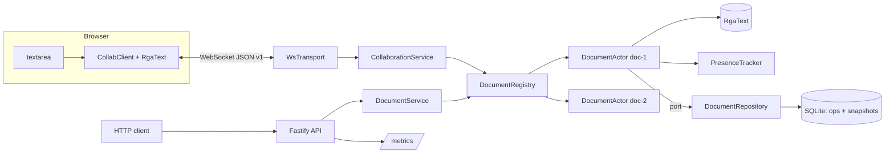

# cosync

A real-time collaborative text editing backend in TypeScript on Node.js, built around a sequence CRDT written from
scratch (no Yjs, no Automerge). Clients edit locally with zero latency, exchange operations over WebSockets, and every
replica converges to the same text regardless of network ordering, duplication or disconnects.

- **CRDT**: RGA (Replicated Growable Array) over Unicode code points, Lamport ids, tombstones, causal buffering,
  snapshots, and safe tombstone garbage collection. Pure code with no I/O, covered by property tests.
- **Sync protocol**: versioned JSON messages validated with zod, state-vector delta sync, acknowledgements, offline
  outbox, presence with heartbeats and timeouts, message size limits and backpressure.
- **Server**: one actor per open document (single-writer mailbox, no locks), a registry that loads and unloads documents
  on demand, SQLite append-only op log with periodic snapshots and compaction, Fastify HTTP API, Prometheus metrics,
  structured pino logs, graceful shutdown that flushes snapshots.
- **Demo**: a static page served by the server; open it in two tabs and type.

## Why a CRDT

The classic alternative is Operational Transformation, which needs a central server to transform every concurrent
operation against every other one, and its correctness proofs are famously fragile. A CRDT makes every operation
commute by construction: replicas can apply the same set of operations in any order and end in the same state. The
server here is still the hub (it persists, relays and garbage collects), but it never has to rewrite anyone's edits, and
clients keep working offline.

## The algorithm

Each inserted character is an element with an id `(clock, replica)`, where `clock` is a Lamport timestamp. An insert
names its **origin**: the element it was typed after (or the start of the document). Deleting only marks an element as a
**tombstone**, because concurrent inserts may still be anchored on it.

To integrate an insert, a replica finds the origin, then skips every following element whose id is **greater** than the
new id, and inserts there. Ids are ordered by clock, then by replica id as a tie breaker.

```
Both replicas start with "ab".  A types "X" after "a",  B types "Y" after "a", concurrently.

    a(1,A)  b(2,A)                          X = (3,A)   Y = (3,B)   =>   Y > X

    A integrates Y:  after a, skip nothing greater than Y ...      a Y X b
    B integrates X:  after a, skip Y (greater than X), insert ...  a Y X b
```

Why it converges: anything typed after an element saw it, so it has a larger clock. When integrating `N` after its
origin, every element we skip is either a concurrent sibling that wins the tie or a descendant of one (larger clock
still), and the first smaller element marks where `N`'s subtree ends. The position depends only on ids, never on
arrival order.

Details that make it production-shaped:

- **Exactly-once, in-order per replica.** Every operation also carries `prev`, the clock of its author's previous
  operation. Lamport clocks have gaps, so without it a receiver could not tell "the next op" from "an op after one I
  lost". With it, a single number per replica (the **state vector**) describes exactly what a replica has seen, which
  makes delta sync and duplicate detection trivial.
- **Causal buffering.** Operations whose origin, delete target or predecessor has not arrived wait in a pending buffer
  and are retried when something new integrates. Delivery order does not matter.
- **Anchors for cursors.** A cursor is sent as the id of the element it sits after, so a remote caret stays attached to
  the same character while others type.
- **Garbage collection.** A tombstone is removed when its deletion is covered by the **stable vector** (the element-wise
  minimum of every known replica's state vector) and no element uses it as origin. Local edits anchor only on visible
  elements, and a replica reports a state vector only after sending its earlier edits over the same FIFO connection,
  so nothing can reference a collected tombstone later. Removing a leaf tombstone does not change where any future
  insert lands; a property test checks exactly this by collecting on one replica only and continuing to edit.

Code: [`src/crdt/rgaText.ts`](src/crdt/rgaText.ts).

## Sync protocol

All messages are JSON with `v: 1`. Client messages are validated with zod (`src/infrastructure/ws/protocolSchema.ts`);
a message with another version is answered with `unsupported_version`.

| Direction | Type        | Payload                                            | Purpose                                                 |
| --------- | ----------- | -------------------------------------------------- | ------------------------------------------------------- |
| C to S    | `hello`     | `docId, replicaId, stateVector, user`              | Join a document, announcing what the client already has |
| S to C    | `welcome`   | `sessionId, stateVector, sync, peers, heartbeatMs` | `sync` is a delta of missing ops, or a full snapshot    |
| C to S    | `ops`       | `ops[]`                                            | Local edits (insert / delete)                           |
| S to C    | `ops`       | `ops[]`                                            | Edits from other replicas                               |
| S to C    | `ack`       | `upTo`                                             | All of your ops up to this clock are durably stored     |
| C to S    | `heartbeat` | `stateVector`                                      | Liveness, and what the client has seen (drives GC)      |
| C to S    | `awareness` | `cursor: { anchor, head } \| null`                 | Cursor and selection as CRDT anchors                    |
| S to C    | `presence`  | `updated[], removed[]`                             | Who is here and where their cursor is                   |
| S to C    | `error`     | `code, message`                                    | Followed by a close with an application close code      |

Flow:

```
client                                server
  | hello {stateVector: {...}}          |
  |------------------------------------>|  sv dominates log base? delta : snapshot
  |        welcome {sync, peers}        |
  |<------------------------------------|
  | ops (outbox not covered by server)  |
  |------------------------------------>|  append to SQLite, then broadcast
  |               ack {upTo}            |
  |<------------------------------------|
  | heartbeat {stateVector} every 5s    |
  |------------------------------------>|  updates the replica's vector, refreshes presence
```

The client keeps every local op in an **outbox** until it is acknowledged. After a reconnect the welcome carries the
server's state vector and the client resends only what is not covered, so offline edits are never lost or duplicated.

Limits and flow control:

- Frames above `MAX_MESSAGE_BYTES` are rejected by `ws` with close code 1009; batches are capped by
  `MAX_OPS_PER_MESSAGE`.
- **Backpressure**: when a connection's send buffer exceeds `BACKPRESSURE_HIGH_WATER_BYTES`, the server drops the
  connection instead of buffering without bound. That is lossless: the client reconnects and receives a delta.
  Presence updates are skipped earlier (`PRESENCE_DROP_WATER_BYTES`), since the next one supersedes them anyway.
  Departures are never skipped, so no ghost cursors remain.
- Sessions that stop sending heartbeats are dropped after `PRESENCE_TIMEOUT_MS` (close code 4408); protocol-level pings
  detect dead TCP connections.
- A session may only author ops for its own replica id (`forbidden_op`).

## Architecture

Hexagonal layout with constructor injection; only `src/server.ts` knows concrete adapters.

```
src/
  crdt/            pure CRDT: ids, state vectors, RgaText (no I/O, no dependencies)
  domain/          DocumentActor, Mailbox, PresenceTracker, ports, typed errors, wire message types
  application/     DocumentRegistry, CollaborationService (session lifecycle), DocumentService (HTTP use cases)
  infrastructure/  ws transport, Fastify HTTP API, SQLite repository, pino logger, Prometheus metrics, clock
  config/          environment parsing and validation with zod
  server.ts        composition root and graceful shutdown
client/            transport-agnostic CollabClient (used by the demo and the tests) and the demo page script
```



Why an actor per document: all state of a document (CRDT, sessions, retained log, replica vectors) is owned by one
object and mutated only by tasks taken from its mailbox, one at a time. There is nothing to lock, ordering is explicit,
and different documents never contend. Per connection, messages are also processed one after another, which preserves
the per-replica FIFO order the protocol relies on.

## Persistence and compaction

- `ops` table: append-only log `(doc_id, seq, replica, clock, body)`. An op is written **before** it is broadcast, so
  nobody ever sees an edit the server could lose.
- `snapshots` table: CRDT state, known replicas with their last state vector, and the log `base`. A snapshot is written
  every `SNAPSHOT_EVERY_OPS` ops, when a document is unloaded, and on shutdown.
- **Compaction**: on each snapshot, log rows that are both folded into the snapshot and covered by the stable vector are
  deleted. The log therefore keeps exactly the ops some known replica might still miss, so reconnecting replicas get a
  delta; a brand-new replica, or one evicted after `REPLICA_TTL_MS` of absence, is behind `base` and gets a snapshot.
- **Recovery**: load the latest snapshot, then replay the remaining log; entries already in the snapshot are detected as
  duplicates by the state vector and skipped. A crash between snapshots loses nothing.
- Schema migrations are versioned with `PRAGMA user_version`; the database runs in WAL mode.

## Running

Requires Node.js 22.5 or newer.

```bash
npm install
npm run build
npm start                      # http://localhost:3000
```

Open `http://localhost:3000`, which creates a document and puts its id in the URL. Open the same URL in a second tab
and type in both. Stop the server, keep typing, start it again: the tab reconnects and syncs.

Development mode with reload: `npm run dev`. With Docker:

```bash
docker build -t cosync .
docker run -p 3000:3000 -v cosync-data:/data cosync
```

Configuration is read from the environment; see [`.env.example`](.env.example).

HTTP API:

| Method | Path                    | Description                                           |
| ------ | ----------------------- | ----------------------------------------------------- |
| POST   | `/api/docs`             | Create a document, optional `{ "text": "..." }`       |
| GET    | `/api/docs/:id`         | Text plus metadata (length, history, tombstones, ...) |
| GET    | `/api/docs/:id/text`    | Current text as `text/plain`                          |
| GET    | `/api/docs/:id/history` | Number of ops ever applied                            |
| GET    | `/health`               | Liveness and basic counters                           |
| GET    | `/metrics`              | Prometheus text format                                |
| WS     | `/ws`                   | Sync protocol                                         |

## Testing

```bash
npm test          # Vitest: unit, property and integration tests
npm run lint      # ESLint (typescript-eslint strict, type-checked) + Prettier compatibility
npm run typecheck # server and browser client
```

- `test/crdt`: unit tests and fast-check properties: random concurrent edits on 2 to 4 replicas delivered in random,
  non-causal orders with duplicates converge; a single writer matches a plain string model; garbage collection on one
  replica does not break later convergence; restoring from a snapshot mid-stream keeps converging.
- `test/domain`: document actor (delta vs snapshot sync, replica spoofing, session replacement, presence expiry, GC
  stability, recovery, shutdown flush), mailbox ordering, presence.
- `test/integration`: a real server on an ephemeral port with real WebSocket clients: three clients editing
  concurrently converge, reconnect with delta sync and offline edits, presence timeout, protocol validation and size
  limits, HTTP API and metrics, SQLite compaction, crash recovery from snapshot plus log, and graceful shutdown.

## Limits

- Integration is O(n) per op (array scan); fine for documents up to tens of thousands of characters. A production
  version would use a balanced tree or run-length encoded blocks, as Yjs does.
- One character per insert operation; pasting a long text produces many small ops (batched per message).
- Clients do not garbage collect; they shed tombstones whenever they rejoin through a snapshot.
- A tombstone that is the origin of a live element is kept forever (it costs an id, not content).
- The server is a single process; horizontal scaling would need document-to-node affinity or a shared op bus.
- No authentication or authorization; any client that knows a document id can edit it.
- The demo textarea computes edits by diffing, and shows remote cursors in a side list rather than inline.

## License

MIT
